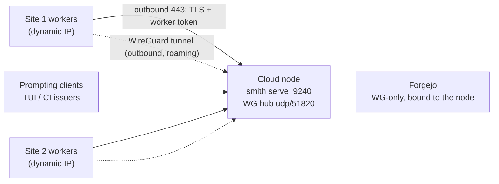

# Cloud deployment: the fleet's home node

Planning sketch for the fleet's next posture: the harness plane runs
persistently on a cloud node; workers dial in from **multiple on-prem
sites** (some with dynamic IPs); prompting clients attach from anywhere.
The architecture already separates the planes — this document is about
*placing* them: what is built, what is configured, and what still needs
design before go-live.

Status: **sketch** — input to planning, not a runbook for production.

## The topology

One node hosts three co-operating services:

- **`smith serve`** — the harness plane (M13), orchestrator host (M15),
  scheduler and credential holder. Public HTTPS behind a reverse proxy.
- **Forgejo** — the forge: source of truth for materialised repos,
  checkpoint branches (`smith/<session>`), and integration branches
  (`smith/integration/<parent>`). **WireGuard-only** — no public code
  surface.
- **The WG hub** — one open UDP port; every site is a peer that dials
  outbound (the same NAT-safe shape as the worker mesh).

Why the forge co-locates with the daemon: once the harness is in the
cloud, the WAN is already on the critical path (every tool call crosses
it on the worker mesh), so an on-prem forge buys little — while one node
means one TLS setup, one backup job, one ops envelope, and a trivially
local token broker (below). The shared-fate objection (node down = harness
*and* forge down) is answered with offsite backups and a push mirror.

## Connectivity decisions

- **Dynamic IPs kill IP allowlisting** — the boundary is credentials and
  keys, never network location. Both services authenticate by possession,
  not by address.
- **WireGuard handles the roaming**: only the hub needs a stable address.
  Peers identify by public key and dial outbound; when a site's IP
  changes, its packets (`PersistentKeepalive = 25`) re-teach the hub the
  endpoint. Nobody configures IPs anywhere. Plain WG (zero third parties)
  at this scale; Tailscale/Headscale if enrolment ever gets tedious.
- **Peers: per host first** (no routing tables, no subnet-overlap
  worries); move to per-site gateway peers with subnet routing only if a
  site grows several workers.
- **The daemon stays public** (TLS + tokens) so thin clients and CI
  issuers attach from anywhere without VPN profiles. Pulling it into the
  WG mesh too would make the node expose *one UDP port total*, at the
  cost of enrolling every human and CI device — revisit if the public
  surface ever becomes a liability.
- **Git stays worker-direct** — do not proxy git through the daemon to
  avoid the tunnel. Worker-direct keeps big payloads off the mesh and
  preserves the disposal-safety story (the forge is *external* state).
  Git ops run on the worker host, outside the sandbox, so egress
  enforcement is untouched.

## Node setup

- **Reverse proxy** (Caddy or nginx): `smith.example.com` →
  `127.0.0.1:9240`; TLS termination, SSE buffering off, modest rate
  limits. The forge never gets a public vhost.
- **Services as podman quadlets** (or systemd units): `smith serve`,
  `forgejo`, `wg-quick@hub`. Forgejo binds to the WG address or
  localhost + firewall; HTTPS over the tunnel is unnecessary (WG
  encrypts), which removes cert management for the forge entirely.
- **Forgejo lockdown**: sign-ups disabled, private repos, admin account +
  per-worker deploy keys or tokens (below).
- **Sizing**: Forgejo is a single Go binary + SQLite — a few hundred MB of
  RAM; disk grows with repos (+LFS if used). Worker bare-clone caches keep
  the WAN traffic to small per-turn deltas.
- **Backups — the non-negotiable**: co-locating the forge with the daemon
  concentrates risk (the forge *is* the disposal-safety layer). SQLite +
  repo dir → offsite (restic/borg to object storage), or Forgejo's
  built-in push mirror to GitHub as a second remote. Either restores the
  forge's independence from the node.

## Credentials

**Now (already implemented):** per-worker deploy keys or forge tokens,
read by workers from the env var named in `WorkspaceSource.token_env`
(default `SMITH_GIT_TOKEN`), injected per git invocation via the
ephemeral credential-helper env — never in process arguments, never on
disk; caches keep clean origin URLs. Forge-agnostic; a cloud forge is
just a different `git_url`.

**Next (the token broker, sketched):** the controller holds the forge
credential and mints a **short-lived, per-session token** at dispatch,
delivered in the `StartSession` command; the worker uses it in memory
only (the mesh is TLS'd; the trust model already gives workers repo
creds, this just makes them ephemeral). Revocation is instant (drop the
token server-side) and no long-lived secret lives on any worker host.
Forgejo's plain token API makes this a small feature; on GitHub the
equivalent wants a GitHub App (installation tokens) — another point for
self-hosting the forge.

## Still to design (before go-live)

In the order ranked when this posture was discussed:

1. **Daemon durability.** Sessions, journals, leases and M15
   orchestrators are in-memory; a restart loses hosted sessions (JSONL
   logs + git branches survive, but there is no recovery path for the
   session table or an in-flight orchestration). The first design to do.
2. **WAN latency budget.** The harness↔execution loop is chatty; with
   both sides now WAN-separated, decide what the budget is (per-tool-call
   round trips) and whether anything needs batching.
3. **Client identity.** One shared daemon bearer token today; per-client
   tokens and a who-did-what audit before the daemon is more than
   single-operator.
4. **Controller-only mode.** A config switch to disable the daemon's own
   podman local-executor sessions (a cloud node should not need a
   sandbox stack).

Runbook details (exact units, firewall rules, peer enrolment steps) land
here as each piece is built. Companion records: `docs/FLEET_ROADMAP.md`
(the arc's decision ledger), `docs/WORKER_MESH.md` (trust model),
`docs/ORCHESTRATION.md` (M15 model).
