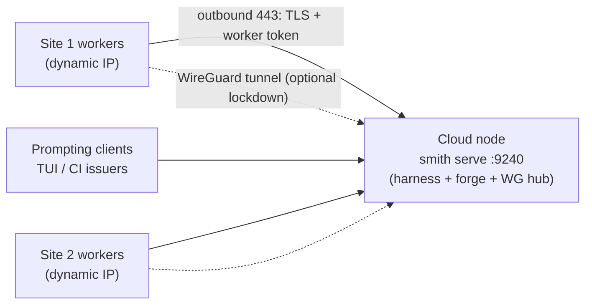

# Cloud deployment: the fleet's home node

Planning sketch for the fleet's next posture: the harness plane runs
persistently on a cloud node; workers dial in from **multiple on-prem
sites** (some with dynamic IPs); prompting clients attach from anywhere.
The architecture already separates the planes — this document is about
*placing* them: what is built, what is configured, and what still needs
design before go-live.

Status: **sketch** — input to planning, not a runbook for production.

## The topology

One node hosts the harness — **which now IS the forge (M17)**:

- **`smith serve`** — the harness plane (M13), orchestrator host (M15),
  durable state (M16), **and the forge**: controller-hosted git repos
  over the smart HTTP protocol, with per-session scoped tokens minted
  in-process (`/git/<repo>/...`; see docs/SERVE_PROTOCOL.md). Public
  HTTPS behind a reverse proxy; no second service, no second auth plane.
- **The WG hub** (optional, for lockdown or admin surfaces) — one open
  UDP port; every site is a peer that dials outbound (the same NAT-safe
  shape as the worker mesh).

Why the forge lives IN the daemon: the controller is the trust root, so
per-session git tokens are minted in-process (the token broker is a
function, not a project); git's protocol work stays in git itself
(`--stateless-rpc` subprocesses — the controller pipes bytes only). The
shared-fate objection (node down = forge down) is answered with offsite
backups of the state dir's `repos/`.

## Connectivity decisions

- **Dynamic IPs kill IP allowlisting** — the boundary is credentials and
  keys, never network location. Both services authenticate by possession,
  not by address.
- **WireGuard handles the roaming**: only the hub needs a stable address.
  Peers identify by public key and dial outbound; when a site's IP
  changes, its packets (`PersistentKeepalive = 25`) re-teach the hub the
  endpoint. Nobody configures IPs anywhere. Plain WG (zero third parties)
  at this scale; Tailscale/Headscale if enrolment ever gets tedious.
- **Peers: per host first** (no routing tables, no subnet-overlap
  worries); move to per-site gateway peers with subnet routing only if a
  site grows several workers.
- **The daemon stays public** (TLS + tokens) so thin clients and CI
  issuers attach from anywhere without VPN profiles. Pulling it into the
  WG mesh too would make the node expose *one UDP port total*, at the
  cost of enrolling every human and CI device — revisit if the public
  surface ever becomes a liability.
- **Git stays worker-direct over HTTP** — workers run their own git
  against the forge endpoint (the daemon only pipes bytes to git
  subprocesses; no pack data rides the worker *mesh*). Git ops run on
  the worker host, outside the sandbox, so egress enforcement is
  untouched.

## Node setup

- **One service**: `smith serve` as a podman quadlet (or systemd unit) —
  harness, forge and durable state in one process.
- **Reverse proxy** (Caddy or nginx): `smith.example.com` →
  `127.0.0.1:9240`; TLS termination, SSE buffering off, modest rate
  limits. Git rides the same origin (`/git/...`).
- **WG hub** (optional lockdown): `wg-quick@hub`, one open UDP port.
- **Sizing**: the daemon is a single Rust binary; disk grows with the
  state dir (journals, transcripts, hosted repos). Worker bare-clone
  caches keep the WAN traffic to small per-turn deltas.
- **Backups — the non-negotiable**: the forge's `repos/` (and the rest of
  the state dir) → offsite (restic/borg to object storage), or a scripted
  mirror to GitHub as a second remote. That restores the forge's
  independence from the node.

## Credentials

**The controller forge (M17, live):** spawns referencing `smith:<name>`
get a **per-session, per-repo scoped token** minted at dispatch and
delivered in `WorkspaceSource.token` (hashed at rest in a `.gitcred`
sidecar; recovered sessions keep pushing with tokens already delivered).
The worker uses it in memory only — ephemeral, instantly revocable, no
long-lived secret on any worker host. Humans use the daemon token with
ordinary git (push-to-create works).

**External forges (unchanged):** per-worker deploy keys or forge tokens,
read by workers from the env var named in `WorkspaceSource.token_env`
(default `SMITH_GIT_TOKEN`), injected per git invocation via the
ephemeral credential-helper env — never in process arguments, never on
disk; caches keep clean origin URLs.

## Still to design (before go-live)

In the order ranked when this posture was discussed:

1. **Daemon durability.** *Built (M16).* The daemon survives its own
   restart: every hosted session's journal is persisted (one envelope per
   line), and recovery rebuilds the session table, labels, agent harness
   and leases from the state dir. Three files per session, three roles:
   the JSONL (transcript + agent history, smith-core's), `.wire` (the
   replay ring + label source), `.orch` (orchestration child records,
   parents only) — plus a `.create` record (the original request) and a
   `.gitcred` (M17, the session's forge token grant). Worker-mode sessions
   recover fully; queued children re-dispatch when a worker appears; a
   worker's first heartbeat re-learns its leases. Local-mode sessions are
   skipped on recovery (their transcripts remain `smith resume`-able).
2. **Forge topology.** *Built (M17) — see Credentials.* The
   repo-topology decision is resolved: the controller hosts git itself;
   external forges remain supported via `token_env`.
3. **WAN latency budget.** The harness↔execution loop is chatty; with
   both sides now WAN-separated, decide what the budget is (per-tool-call
   round trips) and whether anything needs batching.
4. **Client identity.** One shared daemon bearer token today; per-client
   tokens and a who-did-what audit before the daemon is more than
   single-operator.
5. **Controller-only mode.** A config switch to disable the daemon's own
   podman local-executor sessions (a cloud node should not need a
   sandbox stack).

Runbook details (exact units, firewall rules, peer enrolment steps) land
here as each piece is built. Companion records: `docs/FLEET_ROADMAP.md`
(the arc's decision ledger), `docs/WORKER_MESH.md` (trust model),
`docs/ORCHESTRATION.md` (M15 model).
