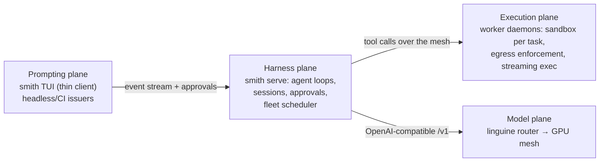

# The fleet arc: decoupled prompting, harness, execution and models

Planning document for smith's next arc. The goal: **separate the machine
issuing prompts from the compute the agent runs on**, and scale that to
multi-agent orchestration — so that prompting, harness, execution and the
model service are decoupled from any single platform architecture.

Companion documents: `README.md` (usage), `ARCHITECTURE.md` (current
single-machine design).

## The four planes

1. **Prompting plane** — the device issuing prompts. Runs the TUI as a thin
   client (or a headless/CI issuer). Never runs the agent loop itself.
2. **Harness plane** — `smith serve`: the controller. Hosts agent loops,
   session logs, the approval router, and the fleet scheduler/lease board.
   Holds the model-plane credentials (the harness is the `/v1` client).
3. **Execution plane** — worker machines running `smith-worker` daemons.
   Each worker owns sandboxes (podman), the egress proxy + nftables
   enforcement, and executes tool calls with streamed output. Workers hold
   **repo credentials only** — never model keys.
4. **Model plane** — linguine (existing project): a router exposing public
   OpenAI-compatible `/v1` over a mesh of GPU workers dialling outbound from
   behind NAT. Smith's `LlmProvider` speaks the same protocol, so the harness
   points at a linguine router with no code — the model plane is already
   decoupled today.

## Principles (largely inherited from linguine)

- **Outbound-only mesh.** Workers dial the controller; no inbound ports on
  worker machines, NAT-safe by construction. Enrolment tokens (PASETO-style,
  revocable) issued by the controller; Ed25519 signer; audit log of every
  tool call and clearance decision.
- **Capability heartbeats.** Workers advertise what they can run — sandbox
  image, installed toolchains, resources, current load — and the scheduler
  dispatches capability-aware with least-connections selection.
- **Disposal-safe state.** A worker is cattle. Workspace state lives in git
  (clone → worktree per task → push branch); harness state lives in the
  session logs (already replay-shaped); nothing durable lives on the worker
  disk. Losing a worker loses nothing but the lease.
- **Sticky leases, not stateless routing.** Unlike inference requests, a
  task's tool calls are stateful and must all land on the worker holding that
  task's sandbox. The scheduler is a job scheduler with leases and heartbeat
  expiry, not a request router.
- **Separation of compute concerns.** GPU machines (model plane) and agent
  machines (execution plane) are distinct fleets, managed by us — resource
  management stays simple and a busy model swap never competes with a
  sandbox build.

## Milestone ladder

- **M12 — remote executor (podman-remote).** `smith run --remote ssh://host`:
  the podman CLI's own remote mode carries the container lifecycle and exec;
  file tools move container-side; the egress stack (sidecar + nftables) runs
  on the remote machine. Proves tool-calls-over-wire and the latency budget
  with the smallest possible diff. Stepping stone to M13/M14.
- **M13 — `smith serve` controller daemon.** The harness plane becomes a
  place, not a process on the prompting device: agent loops run headlessly on
  a controller host, the TUI becomes a thin client over an event stream
  (SSE/WS), approvals round-trip over the same wire. Also the prerequisite
  for fleets: a scheduler cannot be a desktop process.
- **M14 — worker daemon + fleet scheduler.** `smith-worker` enrols, dials the
  controller outbound, heartbeats capability, and leases tasks from the board.
  Workspace materialisation via git; streamed exec events as the wire format;
  native nftables enforcement (closing the machine-ssh limitation on Linux
  workers); git credentials scoped per workspace.
- **M15 — multi-agent orchestration.** Planner/worker separation running *on*
  the fleet: sub-agent spawning, judge-gated finding exchange, worktree
  isolation per agent, merge gates on convergence.

## Open decisions (to settle as the arc proceeds)

- **Controller colocation.** Where the harness runs: on the prompting device
  (Tier-1 style, fine while models are remote via linguine) or on its own
  box. Latency rule of thumb: the harness wants to be near the execution
  plane (the loop is chatty), the prompting plane can be anywhere.
- **Repo topology for materialisation.** Self-hosted Forgejo/Gitea vs GitHub;
  how workers authenticate (deploy keys scoped per workspace vs a forge token
  broker on the controller).
- **Wire protocol.** SSE + REST vs WebSocket vs an NNG-style mesh in Rust;
  linguine's wss-through-reverse-proxy deployment is the proven homelab
  pattern and the default lean.
- **Streaming exec event format.** M13's wire format is the compatibility
  freeze point — design the event stream as the contract.
- **Observability.** Prometheus/OpenTelemetry from the first worker
  (requests, exec duration, queue wait, lease churn, clearance denials) —
  the same advice linguine's review gave, taken.
- **Multi-tenancy.** Single-org (us) first; quotas/auth-zones later.

## Risks

- **State drift.** A lost lease with uncommitted agent work: mitigate with
  periodic checkpoint commits and/or lease-loss commit-to-a-branch.
- **Controller exposure.** Unlike workers, the controller must accept inbound
  connections — TLS, API keys and audit logging are the same pattern as
  linguine's `/v1` and admin planes.
- **Concurrent agents, one repo.** Worktree-per-task plus merge gates keeps
  conflicts reviewable; cross-agent file conflict resolution stays out of
  scope until it hurts.
- **Latency between planes.** Harness↔execution chattiness bounds how far
  apart they can live; keep them colocated (or on the same LAN) by default.
