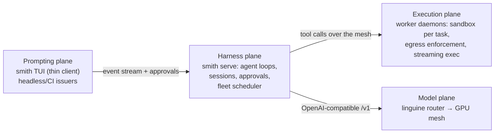

# The fleet arc: decoupled prompting, harness, execution and models

*Complete.* The goal — **separate the machine issuing prompts from the
compute the agent runs on**, and scale that to multi-agent orchestration —
was delivered in four milestones: M12 remote executor, M13 `smith serve`
harness daemon, M14 worker mesh, M15 orchestration (see the ladder below
and `git log`). This document remains as the arc's record: the four
planes, the principles taken from linguine, and what was settled or left
open along the way.

Companion documents: `README.md` (usage, including the orchestration
quickstart), `docs/ARCHITECTURE.md` (how the system is shaped),
`docs/ORCHESTRATION.md` (the M15 model, limits and worked example).

## The four planes

1. **Prompting plane** — the device issuing prompts. Runs the TUI as a thin
   client (or a headless/CI issuer). Never runs the agent loop itself.
2. **Harness plane** — `smith serve`: the controller. Hosts agent loops,
   session logs, the approval router, and the fleet scheduler/lease board.
   Holds the model-plane credentials (the harness is the `/v1` client).
3. **Execution plane** — worker machines running `smith-worker` daemons.
   Each worker owns sandboxes (podman), the egress proxy + nftables
   enforcement, and executes tool calls with streamed output. Workers hold
   **repo credentials only** — never model keys.
4. **Model plane** — linguine (existing project): a router exposing public
   OpenAI-compatible `/v1` over a mesh of GPU workers dialling outbound from
   behind NAT. Smith's `LlmProvider` speaks the same protocol, so the harness
   points at a linguine router with no code — the model plane is already
   decoupled today.

## Principles (largely inherited from linguine)

- **Outbound-only mesh.** Workers dial the controller; no inbound ports on
  worker machines, NAT-safe by construction. Enrolment tokens (PASETO-style,
  revocable) issued by the controller; Ed25519 signer; audit log of every
  tool call and clearance decision.
- **Capability heartbeats.** Workers advertise what they can run — sandbox
  image, installed toolchains, resources, current load — and the scheduler
  dispatches capability-aware with least-connections selection.
- **Disposal-safe state.** A worker is cattle. Workspace state lives in git
  (clone → worktree per task → push branch); harness state lives in the
  session logs (already replay-shaped); nothing durable lives on the worker
  disk. Losing a worker loses nothing but the lease.
- **Sticky leases, not stateless routing.** Unlike inference requests, a
  task's tool calls are stateful and must all land on the worker holding that
  task's sandbox. The scheduler is a job scheduler with leases and heartbeat
  expiry, not a request router.
- **Separation of compute concerns.** GPU machines (model plane) and agent
  machines (execution plane) are distinct fleets, managed by us — resource
  management stays simple and a busy model swap never competes with a
  sandbox build.

## Milestone ladder

- **M12 — remote executor (podman-remote).** *Done.* `smith run --remote
  ssh://host`: the podman CLI's own remote mode carries the container
  lifecycle and exec; file tools move container-side; the egress stack
  (sidecar + nftables) runs on the remote machine. Proves
  tool-calls-over-wire and the latency budget with the smallest possible
  diff. Stepping stone to M13/M14.
- **M13 — `smith serve` controller daemon.** *Done.* The harness plane is a
  place, not a process on the prompting device: `smith-server` hosts agent
  loops, session logs, approval routing and the model keys; the TUI attaches
  as a thin client over the frozen wire contract (`docs/SERVE_PROTOCOL.md` —
  versioned envelopes, SSE event stream, journal replay, first-decision-wins
  approvals with timeout-deny). Loopback today, reverse proxy when it leaves
  the box. Also the prerequisite for fleets: a scheduler cannot be a desktop
  process.
- **M14 — worker daemon + fleet scheduler.** *Done.* `smith-worker` enrols
  (controller-minted one-time tokens → revocable credentials), dials the
  controller outbound (SSE command stream + POSTs), heartbeats capability,
  and leases sessions from the board (capability match, least-loaded,
  queueing, sticky leases, staleness → lease loss). Workspace
  materialisation via git (bare-clone cache + worktree, per-invocation
  credential-helper env) with per-turn checkpoint commits on
  `smith/<session>`; streamed `ExecEvent` telemetry as the wire freeze;
  native nftables enforcement on Linux workers; metrics at `/v1/metrics`.
  See `docs/WORKER_MESH.md`.
- **M15 — multi-agent orchestration.** *Done.* Planner/worker separation
  running *on* the fleet: `spawn_subtasks` creates queued children that
  assemble lazily when their worker lease lands (parallel spawns never
  serialise); a tool-less judge gates every finding (bounded rework rounds,
  pass-through flagged `unjudged`); worker-side merge gates converge
  checkpoint branches onto `smith/integration/<parent>` (`--no-ff`, one
  gate in flight per parent+repo, conflicts surfaced for rework);
  `finish_orchestration` releases the fleet and reports the integration
  branch (`auto_push = false` — humans review by default). One level deep,
  `max_children` as config. See `docs/ORCHESTRATION.md`.

## Decisions: settled and left open (arc record)

- **Controller colocation.** *Settled in posture at M13.* The harness runs
  wherever `smith serve` runs — by default on the prompting device (loopback,
  fine while models are remote via linguine), with `--bind` + a reverse
  proxy when it moves to its own box. The latency rule of thumb stands: the
  harness wants to be near the execution plane (the loop is chatty), the
  prompting plane can be anywhere. Moving the daemon off the box is
  operational work, not a design change.
- **Wire protocol.** *Settled at M13; held through M14/M15 additively.*
  Hand-rolled HTTP/1.1 + REST + SSE, no framework (the egress sidecar's
  pattern; zero new dependencies). The message shapes are the freeze
  (`docs/SERVE_PROTOCOL.md`); every later milestone extended it without a
  version bump. TLS via reverse proxy when the daemon leaves the box —
  linguine's homelab pattern.
- **Streaming exec event format.** *Settled at M14* (`ExecEvent`, telemetry
  only; results travel via correlated op-results).
- **Observability.** *Settled from the first worker.* Prometheus text
  format, hand-rolled (exec duration, queue wait, lease churn, judge
  verdicts, clearance denials).
- **Repo topology for materialisation.** *Still open — the arc's one
  genuine leftover.* Self-hosted Forgejo/Gitea vs GitHub; how workers
  authenticate (deploy keys scoped per workspace vs a forge token broker on
  the controller). Workers hold repo creds as-is today; nothing in the
  mesh forced the decision.
- **Multi-tenancy.** *Left open by design.* Single-org (us) first;
  quotas/auth-zones/per-orchestration cost accounting later.

## Risks

- **State drift.** A lost lease with uncommitted agent work: mitigate with
  periodic checkpoint commits and/or lease-loss commit-to-a-branch.
- **Controller exposure.** Unlike workers, the controller must accept inbound
  connections — TLS, API keys and audit logging are the same pattern as
  linguine's `/v1` and admin planes.
- **Concurrent agents, one repo.** Worktree-per-task plus merge gates keeps
  conflicts reviewable; cross-agent file conflict resolution stays out of
  scope until it hurts.
- **Latency between planes.** Harness↔execution chattiness bounds how far
  apart they can live; keep them colocated (or on the same LAN) by default.
