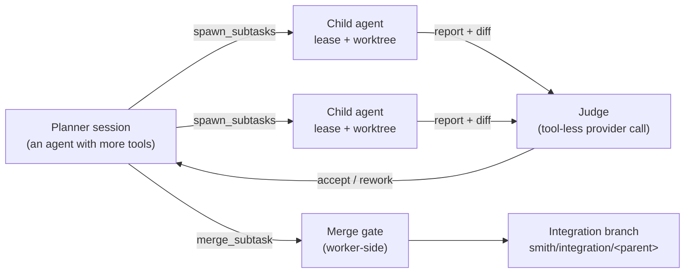

# Orchestration: one prompt in, many agents out (M15)

The fleet arc's final rung. A **planner** session decomposes a task into
subtasks; each subtask runs as its own agent on its own worker lease and
git worktree; a **judge** reviews every sub-agent's findings before the
planner sees them; **merge gates** converge the branches reviewably.
Planner/judge/worker separation, running on the fleet — the whole flow is
driven by model tool calls, exactly like every other tool.

## The model



- **The planner is an agent with more tools.** Opt in with
  `smith run --serve --orchestrate` or `smith attach --orchestrate`; the
  session's tool registry gains five controller-level tools and its system
  prompt gains a planner briefing. The tools close over an orchestrator
  handle and ignore the executor — no smith-core change, no new execution
  paths.
- **Children are queued sessions.** `spawn_subtasks` creates each child's
  journal, approval gate and labels immediately, but the agent assembly
  (materialise → executor → provider → MCP → system prompt) happens when a
  worker lease is granted — a dispatcher task grants leases as workers free
  up and starts each child's first turn. Parallel spawns never serialise on
  worker availability. Single-session creates (`smith run --serve`,
  `smith attach`) keep their blocking-wait behaviour.
- **The judge is tool-less.** After each child turn, `collect_findings`
  sends the subtask, the child's final report, the diff summary and a
  truncated diff to a provider call with no tools, and parses a verdict
  (`accept | rework` + critique). A **rework** critique becomes the child's
  next turn — the verify gate's pattern — up to `judge_rounds`; past that
  the finding passes through flagged `unjudged`. Bounded cost, no silent
  quality claims: an unparseable judge answer is also flagged.
- **Merge gates run worker-side.** `merge_subtask` asks the child's worker
  to merge its checkpoint branch (`smith/<child>`) into the parent's
  integration branch (`smith/integration/<parent>`) in that repo's bare
  clone cache — `--no-ff`, in a temp worktree — and run the configured
  `[orchestrate].gate_command` in a fresh sandbox on the merged tree. The
  result (`{ok, conflict, output}`) goes back to the planner: a conflict or
  failed gate leaves the integration branch untouched and hands the output
  to the planner for rework. Gates are sequenced one in flight per
  (parent, repo), and each gate merges against the **latest** integration
  branch (the branch is pushed to the origin after every successful gate),
  so child 2's gate sees child 1's accepted work.
- **Finish releases the fleet.** `finish_orchestration` releases every
  remaining lease, reports the integration branch(es) and closes the
  orchestration. Pushing the integration branch onto the base ref is
  explicit: `[orchestrate].auto_push`, default **false** — the fleet
  produces reviewable branches, not direct pushes.

## Limits (config, not model judgement)

`[orchestrate]` in `~/.smith/config.toml`:

| Key | Default | Meaning |
|---|---|---|
| `max_children` | 8 | Spawn beyond this errors; the planner sees the error |
| `judge_rounds` | 2 | Rework rounds per child; **0 disables judging** |
| `judge_model` | `""` | Judge model override; empty inherits the session's provider |
| `gate_command` | `""` | Command on the merged tree; empty = merge-only |
| `auto_push` | false | Push the integration branch onto the base ref at finish |
| `collect_timeout_secs` | 1800 | Bounded waits for collects and gates |

Two structural limits: **one level deep** (children never receive
orchestration tools — nesting stays out until it hurts), and children run
approval-free (`auto` mode) — nobody is attached to a child to answer
modals; the judge and the merge gate are the quality control.

With judging disabled and an empty gate command, M15 degrades to plain
parallel spawning on the fleet.

## Worked example

```sh
# Terminal 1 — the controller:
smith serve

# Terminal 2 — a worker (or three):
smith-worker enrol --url 127.0.0.1:9240 --token <token> --name gpu-box
smith-worker run

# Terminal 3 — the planner:
smith attach --orchestrate --repo https://github.com/me/myrepo.git
```

Then just talk to it:

> Refactor the config module: one agent splits `config.rs` into
> `config/` modules, another updates the docs, a third adds tests.

The planner spawns three children (each on its own lease and worktree off
the shared bare-clone cache), collects the judge-gated findings, merges
each with the gate (`gate_command = "cargo test -q"` keeps the integration
branch green), reworks any conflict or failed gate, and finishes — leaving
`smith/integration/<planner-session>` ready for review. The parent's event
stream tells the whole story as `orchestration` events (`spawned`, 
`started`, `judged`, `merged`, `failed`, `released`), and its status lists
the children with their states.

## Wire additions (additive; see SERVE_PROTOCOL.md)

- `WireEvent::Orchestration {parent, child, kind, detail}` — journalled on
  the **parent's** stream; the TUI renders it as a notice.
- `SessionStatus.children: [{id, title, state}]` — skipped when empty, so
  every other session's bytes are unchanged.
- `CreateSession.orchestrate: bool` — the opt-in.
- Worker commands `merge_gate` / `push_branch` and the op results
  `merge_gate {ok, conflict, output}` / `done {output}`;
  `LeaseState` gains `released`.

## Observability

`GET /v1/metrics` gains `smith_judge_total{verdict="accept|rework|unjudged"}`.
Orchestration events and child states are visible in any attached client
via replay.

## Explicitly deferred

Nested orchestration, cross-agent conflict auto-resolution, TUI child
panes / orchestration tree UI, merge review UI (the integration branch is
the review surface), quotas and per-orchestration cost accounting.
